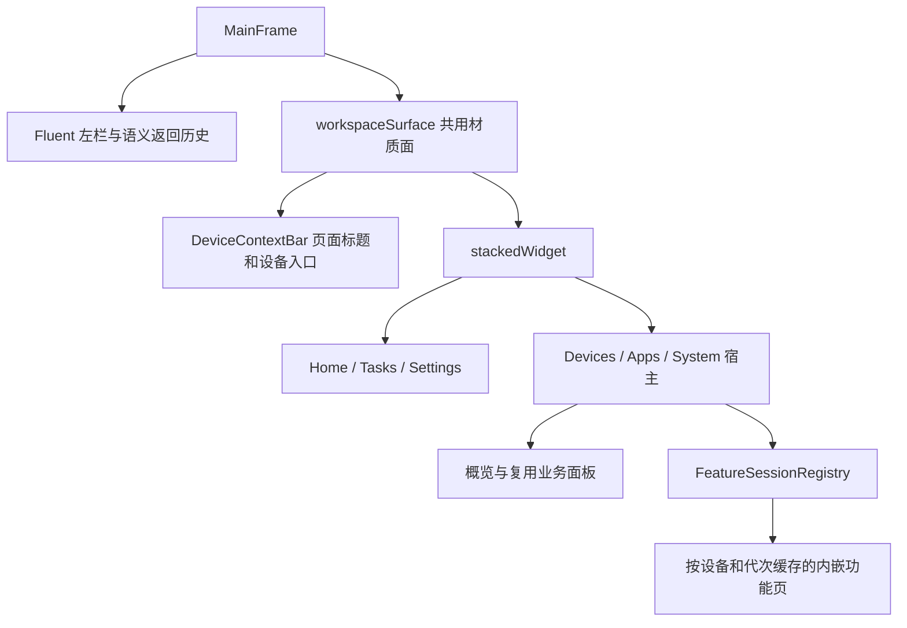

# UI 实现与接入方式

本页记录当前 Python / PySide6 Widgets / PySide6-Fluent-Widgets 界面的构成、共享呈现机制和
接入边界。页面主要由 Python 构造 QWidget 与 Qt 布局，局部使用 QSS 和 QPainter 定制绘制。
它不是新的视觉设计稿，也不把所有页面描述为已经完全统一。

可见功能、设备目标与业务流程以 [BUSINESS_FLOW](BUSINESS_FLOW.md#workspace-路由目录) 为准；
对象归属、线程和关闭以 [ARCHITECTURE](ARCHITECTURE.md) 为准；尚未统一的实现只在
[UI 优化账本](RISKS_AND_DEBT.md#ui-一致性与体验优化)维护。库版本及来源规则见
[DEPENDENCY_MAP](DEPENDENCY_MAP.md#fluent-运行时来源边界)。

## 1. 主窗口与页面组合

[MainFrame](../../gui/main_frame.py) 继承 FluentWindow。`_init_panels_steps()` 将全局设备栏与
`stackedWidget` 放入同一个 `workspaceSurface`，共用内容材质；页面外壳不再各自填一层不透明底色。
左栏使用语义路由，不能由左栏项目数推断物理 QWidget 页数。MainFrame 中宿主内部的功能导航隐藏，
独立使用宿主时仍保留这些接口。

页面名称、设备模式不在这里另建路由表；下面仅说明渲染与容器的实现分工。

| 页面组 | 主要实现 | 容器与内容组织 |
| --- | --- | --- |
| 首页 | [HomePage](../../gui/pages/fluent_pages.py)、[HomeBanner](../../gui/widgets/home_banner.py) | ScrollArea 中放功能入口与摘要；不显示操作设备选择区 |
| 设备概览 | [DeviceHubPage](../../gui/pages/device_hub.py)、[DeviceConnectionPanel](../../gui/widgets/device_connection.py) | WorkspaceSectionPage 的外层滚动区承载设备卡、连接区和详情；展示缓存快照 |
| 应用与诊断、系统工具 | [AppPanel](../../gui/panels/app_panel.py)、[SystemPanel](../../gui/panels/system_panel.py)、[AdaptiveCategoryStack](../../gui/widgets/category_stack.py) | BasePanel 工厂和开放内容分区组成表单；主宿主负责页面滚动与宽度 |
| 远程控制 | [RemotePanel](../../gui/panels/remote_panel.py)、[表单](../../gui/panels/remote_panel_form.py)、[投屏侧栏](../../gui/panels/remote_panel_dock.py) | 主页面承载镜像启动和参数；设备按键与手势由投屏侧栏或便携工具栏提供；不进入按设备创建的 registry |
| 应用管理、文件管理 | [AppManagerPage](../../gui/dialogs/app_manager.py)、[FileExplorerPage](../../gui/dialogs/file_explorer.py) | 工具栏与主列表；列表保留自身滚动、选择、右键和传输/批次反馈 |
| 实时 Logcat | [LiveLogcatPage](../../gui/dialogs/live_logcat.py)、[表单与日志视口](../../gui/dialogs/live_logcat_form.py) | 筛选及命令栏与日志阅读区分开；换行、跟随、空态和横向滚条由日志视口管理 |
| 性能采集 | [PerformancePage](../../gui/dialogs/performance_launcher.py)、[采集状态](../../gui/widgets/performance_sessions.py) | 配置、当前设备会话、指标/输出与归档入口分别组织；多选目标不等于自动批量启动 |
| 截图与屏幕 | [ScreenshotPage](../../gui/features/media.py)、[查看器](../../gui/dialogs/screenshot_viewer_ui.py) | 概览媒体工具重挂到页面，画布保留缩放/翻页语义；释放时归还共用工具 |
| 任务中心 | [TaskCenterPage](../../gui/pages/tasks_page.py)、[操作结果](../../gui/widgets/action_result_view.py)、[测试结果](../../gui/widgets/run_results.py) | 以状态快照增量更新任务行，普通操作正文与跨运行测试记录分开 |
| 设置与关于 | [SettingsPage](../../gui/pages/fluent_pages.py)、[About](../../gui/features/about.py)、[ADB 设置卡](../../gui/widgets/adb_client_card.py) | 设置卡组置于页面滚动区；字体、主题和运行时探测各走自己的更新入口 |

`gui/features/` 是内嵌功能的公开入口。实现放在 `gui/dialogs/` 并不意味着它会打开独立 QDialog；
真实 QWidget 类型、父对象和会话工厂决定窗口形态。功能页创建与重挂需先明确 parent/隐藏状态，
再交给宿主显示，避免第一次选择设备时短暂成为顶层窗口。

## 2. 材质、主题、强调色与字体

### 材质与颜色

- [BaseStyles / ThemeMixin](../../gui/styles/theme.py) 管明暗主题、强调色和应用色板；
  [tokens](../../gui/styles/tokens.py) 提供尺寸等基础值。页面使用语义颜色，不把一次计算的颜色
  当成永久状态。主题、强调色、字体是不同更新来源。
- [window_effects](../../gui/window_effects.py) 管 Windows 窗口材质；
  [material](../../gui/styles/material.py) 根据实际宿主同步控件材质，覆盖延迟创建和重挂。
  设置中启用云母不等于每个平台、每个窗口都已启用原生云母。
- 投屏侧栏和更多面板通过
  [RemoteToolbarMaterial](../../gui/widgets/remote_toolbar_material.py) 独立申请 DWM 背景，
  跟随主宿主实际云母开关及深浅主题；原生调用成功后才让 Qt 表面透出材质。
  不支持或应用失败时保留主题底板。工具窗继续不抢焦点，DWM 可按非激活状态显示实色后备，
  不通过伪造激活状态维持纹理；材质切换不重建按键或改变会话目标。
- [ContentSection](../../gui/widgets/content_section.py) 保留 HeaderCardWidget 的布局接口，
  绕过结构卡片底板和边框绘制，使用标题与留白组织内容。它不要求子按钮、输入框也全部透明，
  也不替代需要常驻边界的交互卡片；章节之间的分割线由消费页面布局决定。
- [reading_surface](../../gui/styles/reading_surface.py) 管只读正文和详情：实际宿主有云母时
  透出内容层，无云母时恢复普通 Fluent 表面；切换材质不重建文档、选区或阅读位置。可编辑输入
  保留输入底板。应用主列表和 Logcat 另有局部材质控制器，不宜用整页 QSS 覆盖它们。
- [combo_menu](../../gui/styles/combo_menu.py) 只在适用宿主给普通参数下拉选项使用 Acrylic 底板；
  能力不足时使用原菜单，背景处理失败时同一菜单回退为可操作的实色底板。设备选择使用页内
  QWidget，与普通参数下拉菜单是两类交互。

### 字体更新

[TypographyManager](../../gui/styles/typography.py) 是字体配置的唯一状态源，提供
`UI / UI_SMALL / TITLE / MONO / LOG` 角色。`apply()` 更新 QApplication 默认字体，再按变化发送
`ui_font_changed`、`log_font_changed` 和 `fonts_changed`；字体设置字段见
[DATA_FLOW](DATA_FLOW.md#设置字段)。

应用默认字体负责未显式设置控件的继承。已经调用 `setFont()`、设置字号 QSS 或自行绘制文字的
控件，需要在相应信号中重新应用角色，同时刷新字体度量相关的行高、列宽或省略位置；不能仅靠
一次构造时 `setFont()` 宣称支持热更新。通用入口为
[apply_font_role / apply_label_role / set_fluent_font_rule](../../gui/styles/fluent.py)；
`apply_font_role()` 只执行当次设置，不自动为控件订阅字体变更信号。
`control_height()` 根据实际字体度量计算最小高度，避免字号改变后仍锁死原高度。

文件管理的路径标签使用 UI、底部状态使用 UI_SMALL；文本预览的两个保存按钮在初建和字体变更时
同步角色字体与最小高度。刷新保留当前目录、手动列宽、列表选择以及预览文档、修改状态和光标位置。

字体 QSS 通过 `adblabFontQss` 与焦点、危险态、禁用材质合成。单独覆盖控件全部 QSS 可能丢失另一个
机制，现有页面刷新时应复用这些合成入口。语言与显示缩放需重启生效，字体、主题和强调色的更新
不应通过销毁持有任务的页面实现；语言资源安装见 [i18n](../../gui/i18n.py)。

## 3. 按钮、输入、图标与焦点

| 场景 | 现有公共入口 | 调用方仍需负责 |
| --- | --- | --- |
| 普通/透明/主按钮 | [configure_button](../../gui/styles/fluent.py)、[BasePanel 控件工厂](../../gui/panels/base_panel.py) | 选择合适按钮种类，投影业务 enabled/checked 状态；配置函数不接管业务状态机 |
| 输入、参数下拉框 | `configure_fluent_control()`、[StrictIntComboBox / StrictIntLineEdit](../../gui/widgets/preset_spin_box.py) | 标签和输入关联、合法值检查、可操作错误提示及提交时再次校验 |
| 无文字按钮 | `set_function_tooltip()`、`configure_button()` | 提供明确的 accessibleName 和动作提示；不能只依赖图标形状 |
| 鼠标无蓝框、键盘有焦点 | `apply_focus_indicator(..., keyboard_only=True)` | 仅给需要该交互的控件显式接入；不能以 NoFocus 或全局删除焦点样式替代 |
| 功能图标 | [get_fluent_icon / ResourceIcon](../../gui/styles/icon_loader.py)、[cached_icon](../../gui/styles/cached_icon.py) | 使用已有语义图标；颜色或功能状态改变时更新图标，不在每次 paint 中重新解析 SVG |
| 临时右键菜单 | [create_transient_menu](../../gui/styles/fluent.py)、[transient_menu](../../gui/widgets/transient_menu.py) | 菜单关闭后释放，但共享 QAction 仍归原页面所有 |

键盘焦点观察器区分 Tab、反向 Tab、快捷键和鼠标来源，并预留相同边宽，避免焦点框出现时挤动
文案。普通按钮仍有自己的默认焦点策略，不能把设备选择区的 `keyboard_only` 描述为全应用默认。

文件表格也接入公共键盘焦点规则，强调色通过主窗口的后代刷新链更新；点击表格视口时取消键盘
外框，Tab、反向 Tab 或按键操作恢复提示。观察器归表格所有，并同时观察表格视口。对 item view
重新应用已合成的 QSS，不手动调用原生样式的 `unpolish()`，避开 Windows Fluent 表格的样式崩溃路径。

BasePanel 的必填字段通过控件持有的反馈对象使用 Fluent `setError()`，首次用户编辑或提交后才
显示错误，不让初始空字段泛红。非法整数/小数提示范围与精度，必填文本提示补全内容；原因通过该
字段的 tooltip 与 accessibleDescription 提供，不弹出新窗口或改变表单高度。修正输入后恢复原提示，
动态范围变化重新校验，禁用时隐藏错误、重新启用后按当前值恢复。提交仍重新校验所有必填字段，
只聚焦首个错误项；错误反馈不放宽设备准入或发送业务信号。Intent 调试保留自身的校验反馈。

图标缓存按来源、主题色和属性区分，GUI 线程复用有界 SVG 解析器，后台绘图独立解析；保留当前
painter 的缩放、旋转和透明度，不缓存整页云母背景，不替换未知图标或库的全局绘制函数。
文件浏览器是有意保留的例外：[file_explorer_icon](../../gui/dialogs/file_explorer_list.py) 使用 Qt
原生 SVG 图标，避免 Windows 退出阶段的 Python QIconEngine 生命周期问题；主题变化时由页面
`_refresh_icons()` 重绑定，不应为统一缓存而移除该兼容路径。
Logcat 的“跟随/换行”使用 [LogcatReadingButton](../../gui/dialogs/live_logcat_controls.py) 局部绘制：
QAction 保存状态，开启时图标使用应用强调色，文字和底色沿用普通工具按钮，不绘制底部指示线。

## 4. 页面边界与响应式布局

[WorkspaceSectionPage / GalleryPage](../../gui/pages/fluent_pages.py) 将滚动容器铺到内容区边界，
阅读留白由内部 wrapper 承担。主列表、日志和图片画布保留专用滚动边界；不能为对齐文字同时把
滚动轨道向内缩，也不能把横向溢出简单统一为始终隐藏。

响应式表单沿用三层实现：

1. [responsive_layout](../../gui/widgets/responsive_layout.py) 用 `LayoutContext / ItemMetric /
   WidthPolicy / GridMode` 做纯布局规划；实际字体、可用宽度和控件语义决定换行与列数。
2. [ResponsiveGridBinding](../../gui/widgets/responsive_binding.py) 度量真实 QWidget，缓存最近规划；
   位置与列数不变时原位更新尺寸和 stretch，避免重复摘除、重挂控件。
3. [ResponsiveCoordinator](../../gui/widgets/responsive_coordinator.py) 合并事件并在有界轮次内收敛。
   [layout_settle](../../gui/widgets/layout_settle.py) 在页面成为当前页、首帧绘制前，同步落实宿主
   几何及共享响应式计划；剩余变化由协调器继续有界收敛。展开过渡期间暂停相关响应式重排，
   结束后再处理积累的变化，避免动画与布局相互触发。

[window_layout](../../gui/window_layout.py) 与 [ScreenAdapter](../../gui/screen_adapter.py) 分离用户
首选窗口尺寸和当前屏幕约束。临时受限屏幕的裁剪不应覆盖用户首选尺寸。
[FramelessResizeController](../../gui/widgets/frameless_resize.py) 为可见覆盖滚动条让出输入热区，
并合并滚动条及祖先几何事件的遮罩计算。

## 5. 设备选择、连接与展开

[DeviceContextBar / DevicePicker](../../gui/widgets/device_context_bar.py) 消费现有设备与会话快照，
不重新建立设备状态源，也不为展示字段额外执行 ADB。候选行复用同一布局，采用共享列宽、单行
省略和右侧状态/操作区域；单选、多选、五行高度及极短窗口上限的准确规则统一见
[操作设备入口](../guides/OPERATION_RESULTS.md#统一操作设备入口)。

设备选择、[连接面板](../../gui/widgets/device_connection.py)和
[设备详情](../../gui/pages/device_hub.py)分别持有自己的裁切动画。内容保持自然布局，外层改变可见
高度；快速反向从当前位置继续，收起后的可交互性与焦点链必须同步。MainFrame 聚合这些过渡，
最后一个结束后才恢复工作区规划，避免一处展开结束提前放开另一处的重排。

视觉动画不承担业务取消：收起连接区即使仍在播放动画，也要立即失效请求、清理秘密并请求取消。
扫码、配对码和 IP 的成功/失败/取消状态与高度策略见
[连接设备流程](BUSINESS_FLOW.md#2-连接设备与读取信息)。

## 6. 滚动、动画与绘制开销

| 对象 | 当前机制 | 保留边界 |
| --- | --- | --- |
| 普通页面、像素列表/表格、图表滚动区 | [use_smooth_scroll](../../gui/styles/fluent.py) 安装局部 [SettingsWheelScroll](../../gui/widgets/settings_scroll.py)；先停用旧 Fluent 滚动引擎，重复安装复用同一控制器 | 只接管普通纵向鼠标刻度；触控板、横向和带修饰键输入保留原处理 |
| 普通滚轮续接 | 无回弹阻尼，同向续接位置、速度与时钟；反向清除旧余速，待执行距离限制在一页内 | 外部定位、拖动、范围变化、隐藏和关闭取消旧目标 |
| QPlainTextEdit 和按项滚动视图 | 关闭旧缓动后保留原生步长 | 日志滚条可能使用行单位，不应直接套像素动画；跟随、选区、换行由专用阅读代码维护 |
| 图片画布、菜单及兼容横向工具条 | 使用各自输入与导航规则 | 图片滚轮缩放/翻页不是页面纵向滚动，不强制统一 |
| 设备选择/连接/详情、两张 ADB 设置卡与像素滚动 | [FrameAnimation](../../gui/widgets/frame_animation.py) 使用 PreciseTimer 和真实经过时间；QVariantAnimation 仅用于停止态插值 | 屏幕刷新率只决定近似采样间隔；跨屏不重置进度，不代表垂直同步或实测帧率 |

FrameAnimation 空闲不启动计时器，隐藏、最小化和关闭时停止；终态几何由控件提交。它只弱引用
祖先窗口，不延长外层窗口寿命。没有替换 Qt 或 Fluent 的全局动画，因此不能把“局部高刷时钟已接入”
表述为“所有第三方控件动画已适配高刷”。

当前绘制减负包括静态 SVG 缓存、响应式规划缓存、任务行按快照增量更新、应用列表局部绘制，以及
隐藏性能页暂存日志后在激活时刷新。日志保留、批次渲染和阅读位置由各页面实现，不用减少业务采样
或丢弃有效数据冒充绘制优化。相关消费者分别在
[任务中心](../../gui/pages/tasks_page.py)、[应用行](../../gui/dialogs/app_manager_rows.py)、
[性能日志](../../gui/dialogs/performance_launcher_log.py)和
[Logcat 数据流](../../gui/dialogs/live_logcat_stream.py)。

## 7. 交互状态、反馈与资源归属

`WorkspaceFeatureHost` 负责无设备/关闭中占位和可见页切换，`FeatureSessionRegistry` 负责按功能、
设备和代次复用页面。`deactivate()` 表示离页，不等于停止后台任务；`request_dispose()` 需要等待
资源释放，停止动作始终绑定原任务设备。契约和关闭信号见
[功能会话与路由](ARCHITECTURE.md#功能会话与路由)，不能用动画结束代替资源退出。

通用操作通过 ActionResults 和 ActionFeedbackPresenter 投影到任务中心及非阻塞 InfoBar；
Logcat、性能采集、文件列表、截图等页面保留自己的业务内容。提示分级、任务正文、附件和
通知保留规则只在 [操作反馈指南](../guides/OPERATION_RESULTS.md) 展开。

Logcat 空态由采集状态和缓冲区共同决定，在视口内绘制提示，不向日志文档插入占位文字。
清空显示、停止采集和暂无匹配日志是不同状态；按钮与提示不能各自推断一套采集状态。
实现入口为 [LiveLogcatStream](../../gui/dialogs/live_logcat_stream.py) 与
[_LogcatOutput](../../gui/dialogs/live_logcat_form.py)。
空态标题、操作提示及采集状态通过内嵌的简中、繁中、英文词库翻译；日志正文和原始错误不由
界面词库改写。修改提示时同时更新三语言词库及生成资源，并用实际页面验证等待应用、启停、
断开、失败和清空后的提示，不能只检查 `.ts` 中存在字符串。

## 8. 按现有体系接入与验证

新增或调整 UI 时，沿现有调用链选择宿主和组件：先明确设备目标及会话归属，再使用公共控件工厂，
接入字体/主题/材质变化，最后处理几何、滚动和隐藏/关闭。仅当已有机制不能表达业务时再增加局部实现。
固定尺寸并非一律错误：图标、预留候选行与受控工具按钮可以有明确约束，文本可读性仍需用真实字体
度量验证。不能以全局禁用焦点、整页填底色或强制重建页面来解决局部外观问题。

以下是可选的直接验证入口，不表示本页维护时执行过全套 UI 测试；测试选择规则见
[TESTING_GUIDE](../guides/TESTING_GUIDE.md#增量验证策略)。

| 修改边界 | 代表性测试（位于 `tests/`） |
| --- | --- |
| 材质与窗口边界 | `test_navigation_rendering.py`、`test_reading_surface.py`、`test_scrollbar_resize_hit.py` |
| 字体与主题状态 | `test_typography_core.py`、`test_feature_typography.py`、`test_settings_typography.py`、`test_navigation_theme.py` |
| 按钮与键盘 | `test_accessibility_contract.py`、`test_button_tooltips.py`、`test_device_context_bar_presentation.py`、`test_file_explorer_focus.py` |
| 表单错误与原因翻译 | `test_responsive_panels.py`、`test_global_device_context.py`、`test_i18n.py` |
| 设备选择与连接 | `test_inline_device_selector.py`、`test_device_selector_animation.py`、`test_connection_expansion_animation.py`、`test_wireless_pairing_layout.py` |
| 详情与设置展开 | `test_device_details_animation.py`、`test_settings_expand_animation.py` |
| 响应式与滚动 | `test_responsive_layout_controller.py`、`test_page_scroll_integration.py`、`test_page_scroll_edges.py`、`test_scroll_reflow_efficiency.py` |
| 动画与缓存 | `test_frame_animation.py`、`test_settings_scroll.py`、`test_cached_icons.py`、`test_ui_incremental_updates.py` |
| 会话与空态 | `test_feature_contracts.py`、`test_workspace_feature_host.py`、`test_live_logcat_empty_state.py` |

离屏验证适合字段对齐、事件顺序、缓存复用和终态几何；原生云母观感、不同显示器的实际滚动帧时、
触控板输入及真实设备下的交互负载仍需目标环境验证。文档链接检查只证明引用与元数据有效，
不能代替上述行为验证。
