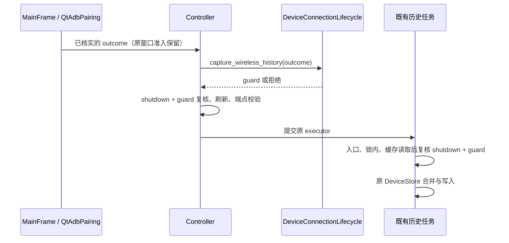

# Controller 设备连接生命周期依赖收敛设计

状态：2026-10-23 已获批准，代码已按本设计接入；阶段验证与独立审阅记录见实施计划。
承接 [APK 文件选择依赖收敛](2026-10-23-controller-apk-picker-design.md)，对应
[实施计划](../plans/2026-10-23-device-connection-lifecycle.md)。

## 1. 目标与范围

将无线配对接纳与 ADB 重启对 `window_owner` 的结构性依赖移到明确的适配边界：
Controller 不再读取窗口的 `_adb_pairing`、`_closing`，也不查找窗口上的重启回调。
保持现有入口、检查时机、异常语义、任务归属和数据兼容，沿用 Python 3.11、PySide6 及现有依赖。

本阶段新增一个应用层协议模块、一个 presentation 适配模块，接入
Controller 和 MainFrame，并迁移直接测试；不重写配对状态机、运行时探测、扫描、关闭或存储。
继续采用主 agent 串行实施、完成后独立审阅的工作方式。

## 2. 实施前依赖与必须保留的时序

| 路径 | 当前行为 | 必须保留的约束 |
| --- | --- | --- |
| `QtAdbPairing._settle_resources` → `connected` | 线程 join、原生 scope 与清理归属确认后，设置 verified outcome 才交付 | outcome_ready 不等于可接纳的 connected；不提前交付 |
| `MainFrame._on_wireless_connected` | 窗口未关闭、当前 pairing 存在且 accepts_outcome 为真才交给 Controller | 保留这层检查，不把 Controller 当作唯一准入点 |
| `ADBDeviceMixin.accept_wireless_connection` | 再次动态取得 owner/pairing 并验证结果，捕获 revision；复核后刷新设备，再校验连接端点 | 非法端点仍刷新，但不安排历史任务；不新增全局成功 Toast |
| 同方法内 `_is_current` | 比较 Controller shutdown、owner identity/closing、pairing identity/revision | 刷新前、后台任务进入、获得概览写锁后、读取缓存后重复检查；submit 被拒绝后也据此决定是否记录警告 |
| 同方法内 `_save_history` | 已有 executor 与概览写锁内读取 DeviceStore，按 transport 查 live 缓存，按端点查历史，合并后写入 | 不追加 ADB 属性查询；保存失败只记录固定诊断，不能撤销已核实连接 |
| `ADBDeviceMixin.restart_adb` | 动态调用 owner.invalidate_wireless_pairing("server_restart")，再提交 model | 无 owner/无可调用回调时仍提交；失效回调抛错则不提交 |
| `_process_restart_adb_result` 成功 | 动态调用 owner.note_adb_server_restarted，安排 3000 ms 刷新，再发送原成功反馈 | 通知先于 timer；timer 的 QObject context 仍为 Controller.signals |
| 同方法失败 | 只发布原失败反馈 | 不通知 runtime、不安排成功刷新；已经撤销的配对资格不恢复 |
| `MainFrame.note_adb_server_restarted` | 非关闭时通知 environment，随后使 scan snapshot 失效 | 此方法没有安排 timer；scan 失效原本没有与 environment 相同的 closing 限制 |

代码依据：`controllers/_device.py:133`、`:463`、`:471`，`gui/main_frame.py:508`、`:624`、
`:630`、`:2290`，`adblab/presentation/qt_adb_pairing.py:282`、`:344`、`:394`。
长期行为说明见[架构](../../project-knowledge/ARCHITECTURE.md#协调与执行边界)、
[连接流程](../../project-knowledge/BUSINESS_FLOW.md#2-连接设备与读取信息)、
[历史数据流](../../project-knowledge/DATA_FLOW.md#设备发现与元数据流)。行号为本轮工作树定位提示。

线程边界：配对服务在 QThread；结果验证、窗口通知与重启结果分派在 GUI 线程；历史写入在
Controller executor。`context_revision` 属性专供后台读取标量，后台不调用 accepts_outcome 或控件方法。
CloseController 先设置窗口 `_closing=True`，随后后台 Controller.shutdown 才设置 `_shutting_down=True`，
两者不能合并。资源退出仍由原 TaskSupervisor、model 和 executor 管理。

## 3. 方案比较与选择

| 方案 | 收益 | 代价与结论 |
| --- | --- | --- |
| **窄生命周期接口 + 动态历史 guard（推荐）** | 原检查可逐项搬移，Controller 不认识窗口结构；与上一阶段显式注入方式一致 | 兼容适配器仍解析 window_owner，后台仍读取既有 Python 属性；不宣称彻底摆脱 Qt 对象关联 |
| 纯 Python 生命周期状态与 token | 后台只读独立状态，可最终消除窗口引用 | 必须同步 owner 重绑定、pairing 替换/revision、最早关闭准入等多个写点，易漏同步；需要独立阶段 |
| GUI 统一接管配对、重启、刷新及历史 | 可集中流程 | 要迁移命令与反馈作用域、执行器和关闭归属，超出当前行为保持型重构 |

采用第一种方案。无线历史准入、重启前撤销和重启成功通知同属连接环境生命周期，
以一个三方法接口表达；不扩为通用窗口服务容器。

## 4. 新接口与对象归属

### 4.1 应用层协议

新增 `adblab/application/device_connection_lifecycle.py`：

```python
class WirelessHistoryGuard(Protocol):
    def is_current(self) -> bool: ...

class DeviceConnectionLifecycle(Protocol):
    def capture_wireless_history(
        self, outcome: PairingOutcome,
    ) -> WirelessHistoryGuard | None: ...
    def invalidate_wireless_pairing(self, reason: str) -> None: ...
    def note_adb_server_restarted(self) -> None: ...
```

模块运行时只依赖标准库；PairingOutcome 仅在 TYPE_CHECKING 导入，使用延迟类型注解，
不因导入协议加载 services、controllers 或 Qt。不改变 PairingOutcome 字段和包导出。

capture 和两个通知方法仅 GUI 线程同步调用。capture 返回 None 表示拒绝；返回 guard 后仍须
动态复核，不能冻结成一次 True。guard 可在 GUI/executor 调用，不做 I/O、不调用 Qt 方法，
不访问控件；每次读取当前身份、revision 和窗口 closing。异常不在适配层转成成功或空结果。

### 4.2 窗口适配器

新增 `adblab/presentation/qt_device_connection_lifecycle.py::QtDeviceConnectionLifecycle`：

```python
def __init__(self, owner_provider: Callable[[], object | None]) -> None: ...
```

普通 Python 对象，无 QObject、线程、Timer、信号或关闭接口。构造只保存 provider，不调用它，
不创建 QtAdbPairing。provider 必须允许 GUI 和 executor 读取，只能取得 Python 对象引用，不能调用控件。

- capture 每次解析当前 owner 与 `_adb_pairing`，沿用 owner closing、callable accepts 和
  `accepts_outcome(outcome)` 检查；捕获 owner、pairing、outcome.context_revision，返回私有 guard。
- guard 持有与原闭包相同的强引用，逐次核对 provider 返回对象仍是 owner、owner 未关闭、
  owner._adb_pairing 仍是 pairing、pairing.context_revision 仍等于捕获值。身份使用 `is`，不能改成 `==`。
- Controller 自身的 `_shutting_down` 仍由 Controller 检查，与 guard.is_current() 短路组合。
  不让 presentation 反向读取 Controller 内部状态。
- 两个通知每次重新解析 owner，只对可调用的同名窗口方法进行转发。无 owner/缺失/不可调用时
  无操作，保持旧兼容行为；不增加适配器自己的通用 closing 判断，不吞回调异常。
- 不增加默认接纳：无 owner 或无合法 coordinator 时无线 capture 返回 None；重启仍可无窗口提交。

### 4.3 构造兼容与 MainFrame 装配

公开门面增加可选仅关键字参数，保持旧参数与顺序：

```python
ADBController(log_service, *, load_device_history=True, apk_picker=None, device_lifecycle=None)
```

仅当 `device_lifecycle is None`，门面惰性导入上述适配器并使用 `lambda: self.window_owner`。
显式注入的假值对象必须保留。内部 `_ADBControllerBase` 要求 `device_lifecycle`，保存为同名属性，
其余初始化次序不变；业务 mixin 不增加缺省 fallback，手工 `__new__` 测试工厂显式安装依赖。

MainFrame 在原 Controller 构造点创建一个窗口专属适配器，两个 history 分支都显式传入。
provider 采用 `lambda: self.adb_controller.window_owner`：构造期间不执行，Controller 保存完成并
设置 owner 后才使用。这样后续直接替换 window_owner 仍能使旧 guard 失效，不能改为固定捕获 self。
该 provider 在后台仅读取 Python 引用，不调用 Qt。不同 MainFrame 的适配器和 guard 不共享状态。

暂留 `_ADBControllerBase.window_owner=None` 和 MainFrame 的赋值；上一阶段默认 APK picker
仍延迟读取它。当前重构的验收是 `_device.py` 不再穿透窗口结构，不是删除所有 window_owner。

## 5. Controller 迁移与兼容矩阵



| 情形 | 保持的结果 |
| --- | --- |
| 复制 outcome、旧 request/revision、未确认身份 | 由原 accepts_outcome 拒绝；不刷新、不提交历史 |
| owner/pairing 更换但 revision 恰好相同 | 旧 guard 失效，不误用新对象 |
| 窗口关闭已开始、Controller shutdown 尚未开始 | owner closing 立即拒绝历史准入与未开始的写入 |
| 等锁或读缓存期间环境改变 | 在原复核点拒绝写入，不把检查只留在任务开始 |
| 缺少合法连接端点 | 已接纳结果仍刷新，不提交历史；不拿配对端口代替连接端口 |
| 存储失败/执行器拒绝 | 保持原固定警告、无新增 Toast，不暴露异常正文和真实标识 |
| 重启失效回调异常 | 向原调用链传播，不提交 model |
| model 提交异常或返回失败 | 不恢复旧 pairing 资格；不新增成功通知/延迟刷新 |
| 成功通知异常 | 不继续 timer/成功反馈，由原分派层报告失败 |
| 重启成功 | note 通知 → `QTimer.singleShot(3000, self.signals, self.refresh_devices)` → 原成功反馈 |

历史别名、`ip/Brand/Model/Aversion`、缓存优先顺序、YAML 路径/格式、IP 过滤规则均不变。
不写入配对码、二维码、配对端口、GUID 或无线 transport ID；不增加持久化字段、设置或迁移。

## 6. 明确保持的行为边界

- 已受理历史的后台 guard 原本不再次判断 request_id、verified identity 或 pairing 自身 closing。
  普通 cancel/新请求若没有改变环境 revision、owner 或窗口 closing，不额外撤销已受理历史。
  本阶段不将其强化为“取消任何配对活动都回滚历史”；GUI 新准入仍使用完整 accepts_outcome。
- 最后一次 guard 检查与 DeviceStore.add_device 不是原子事务；进入 add_device 后，包含其内部锁等待
  和存储 I/O，沿原逻辑自然完成。关闭等待资源排空，不承诺撤销已开始的写入。
- 不改变 model `kill-server → sleep(1) → start-server`。kill 成功/start 失败仍走失败分支；
  已开始的重启方法在关闭时是否继续 start-server 沿原模型边界，不在本批增加取消协议。
- `note_adb_server_restarted` 不替换成 recheck；后者会重解析路径并恢复自动选择，语义不同。
  不移动 3000 ms timer，也不统一 MainFrame environment/scan 原本不同的 closing 条件。
- 不移除 MainFrame 的第一层 accepts，不修改 PairingService、QtAdbPairing、QtAdbRuntime、
  core runtime、CloseController、TaskSupervisor、DeviceStore、设备选择上下文或 CI/发布流程。

## 7. 验收要求

协议导入无 Qt；构造惰性；显式/缺省/假值注入与 owner 后绑定兼容；原始结果身份和双关闭检查保留；
guard 的动态拒绝涵盖排队、锁等待、读缓存；后台不调用 accepts；重启成功/失败/异常和 timer 归属保持；
主窗口两种启动方式和历史加载分支全部注入，原信号和 ActionResults 请求归属不变。
详细测试、变更文件和执行顺序见实施计划。

离屏、fake service、临时历史文件和确定性 Event/Barrier 足以验证本批契约；实机扫码/配对、真实
服务重启和关闭中的操作系统/设备结果仍需人工验收。未执行的检查不能表述为通过。
