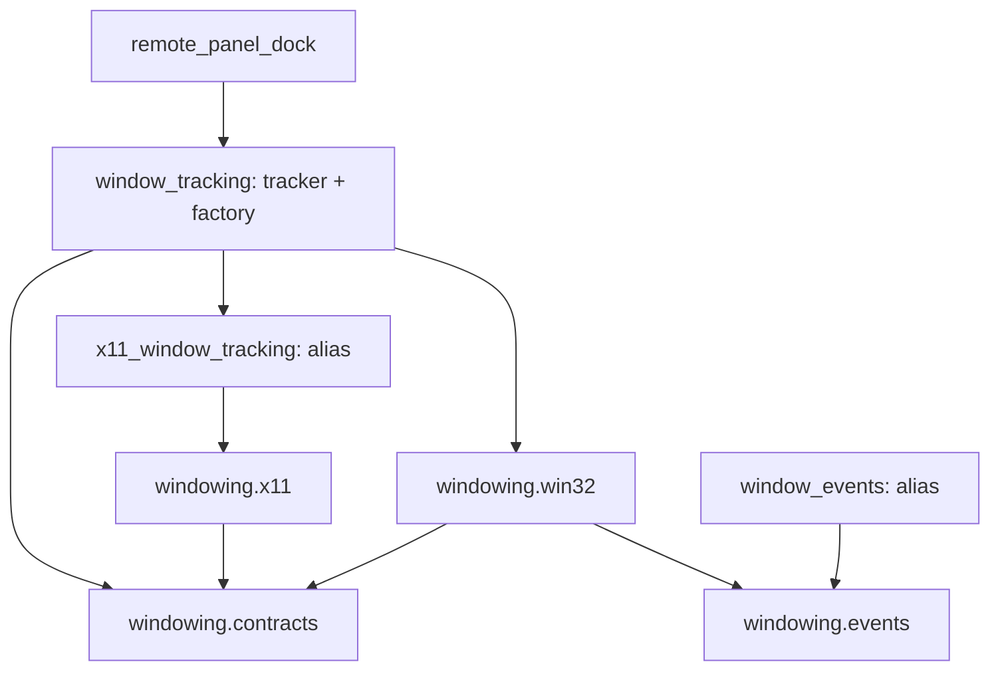

# Remote 原生窗口功能包设计

日期：2026-10-24。状态：实施、独立任务审阅及最终集成审阅均已通过。

## 目的与决策

把窗口跟踪的公共类型、Win32、X11 和 WinEvent 适配分别归入
`services/remote/windowing/`，解除 X11 为取得 DTO 而回导跟踪策略的依赖。
`services/remote/window_tracking.py` 保留真正的 `WindowsWindowTracker` 和
`create_window_tracker`，维护既有调用路径和模块 globals 替换语义。

用户已授权持续结构重构与自主决策；这是实现者依据代码选择的本阶段方案，不描述为用户逐项选择。
已有审计见 忽略工作区 `.superpowers/sdd/2026-10-23-project-refactor/remote-window-structure-design.md`。
设计阶段只形成方案，未改生产/测试或执行pytest；后续实施与验证结果见配套计划的验收记录。

### 方案比较

| 方案 | 收益与代价 | 决策 |
| --- | --- | --- |
| 只提取 contracts | 解开 X11 类型回导，但 Win32 与策略仍混在同一文件 | 可行但归位不完整 |
| 提取 contracts 和三份平台实现，策略/工厂原地 | 职责清晰，原调用与 patch 边界直接保留，无额外兼容装配 | 本草案采用 |
| 同时迁移 tracker/factory | 路径更整齐，但类函数 globals 改变，必须补 wrapper/注入/代理才能维持旧替换点 | 本阶段不采用 |

非目标：不更改窗口匹配、PID 归属、焦点、几何、DPI、便携工具栏、事件或关闭行为；
不合并后台聚焦服务 `window_manager.py`；不新增依赖、修改 CI/版本/数据格式。
禁止通用动态代理、修改 `sys.modules` 实现兼容、重复实现类、复制全局资源集合。

## 文件结构与精确符号所有权

```text
services/remote/
  window_tracking.py          # 实际 tracker/factory 与兼容别名
  x11_window_tracking.py      # X11WindowApi 同对象别名
  window_events.py            # WinEventSubscription、retained set 同对象别名
  windowing/
    __init__.py               # 仅中文包说明
    contracts.py              # 类型、DTO、三个协议
    win32.py                  # Win32 ABI 和窗口 API
    x11.py                    # X11 ABI、连接、查询与定位
    events.py                 # WinEvent hook 与唯一 retained set
```

| 目标文件 | 唯一定义/所有权 |
| --- | --- |
| `windowing/contracts.py` | `PhysicalRect`、`NativeWindowSnapshot`、`_WindowApi`、`_WindowSubscription`、`_EventWindowApi` |
| `windowing/win32.py` | `_ProcessEntry`、`_MonitorInfo`、`_Win32WindowApi`；原 ABI 字段、argtypes/restype、指针宽度原样迁入 |
| `windowing/x11.py` | `_ERROR_LOCK`、`_Display`、`_Window`、`_Atom`、`_BytePointer`、`_XWindowAttributes`、`_XErrorEvent`、`_XErrorHandler`、`_XMonitorInfo`、`_load_x11`、`_load_xrandr`、`X11WindowApi` |
| `windowing/events.py` | `_LOGGER`、`_FOREGROUND = 0x0003`、`_OWNER_EVENTS = frozenset({0x0016, 0x0017, 0x8001, 0x8002, 0x8003, 0x8004, 0x800A, 0x800B, 0x800C})`、唯一 `_RETAINED_SUBSCRIPTIONS`、`WinEventSubscription` |
| `window_tracking.py` | 原 `_LOGGER`、`WindowsWindowTracker`、`create_window_tracker`；保留 `logging/os/sys/time/Callable` 依赖与原函数 globals |

旧 `window_tracking.py` 显式重导出 contracts 的五个名称及 `_Win32WindowApi`，用
`from ... import Name as Name` 明确 alias，避免依赖未使用 import 豁免。
旧 `x11_window_tracking.py` 仅显式重导出 `X11WindowApi`；旧 `window_events.py` 仅显式重导出
`WinEventSubscription` 和 `_RETAINED_SUBSCRIPTIONS`。不新增 `__all__` 来改变原通配导入行为，
不重导出未发现消费者的 `_ProcessEntry/_MonitorInfo`、X11 私有 ABI/loader 或 events 常量。
新包 `__init__.py` 不聚合任何对象；原 `services.remote.__init__.py` 不改。

类迁移后 `__module__` 改为新定义路径，不伪装旧路径；本次精确引用搜索未发现该 DTO 的持久化、
pickle 或反射消费者。events `_LOGGER = logging.getLogger(__name__)` 随实现模块迁入，诊断 logger
名称变为 `services.remote.windowing.events`；当前仓库未发现针对旧名称的过滤配置，正文不变。
这两个元信息变化应在最终报告明确，不能声称所有反射元信息保持不变。

## 契约与依赖

```python
PhysicalRect = tuple[int, int, int, int]

@dataclass(frozen=True)
class NativeWindowSnapshot:
    hwnd: int
    pid: int
    rect: PhysicalRect
    work_area: PhysicalRect
    visible: bool
    minimized: bool
    foreground: bool
    topmost: bool
    dpi: int = 96
    foreground_hwnd: int = 0
```

三个协议保持现有签名：

- `_WindowApi.process_parents() -> dict[int, int]`、`window_handles() -> list[int]`、
  `identity(hwnd: int) -> tuple[int, str] | None`、`snapshot(hwnd: int) -> NativeWindowSnapshot | None`、
  `position_tool(tool_hwnd: int, owner: NativeWindowSnapshot, rect: PhysicalRect) -> bool`。
- `_WindowSubscription.active -> bool` 为只读 property；`close() -> None`。
- `_EventWindowApi.subscribe_changes(hwnd: int, pid: int, callback: Callable[[], None]) -> _WindowSubscription | None`；
  保留 `@runtime_checkable`，不并入基础协议，不向基础协议添加 `close()`。

`WindowsWindowTracker(root_pid: int, title: str, *, api: _WindowApi | None = None,
clock: Callable[[], float] = time.monotonic, discovery_interval_seconds: float = 0.25)` 原地；
`create_window_tracker(root_pid: int, title: str, *, platform_name: str) -> WindowsWindowTracker` 原地。
属性 `supported/lost/event_tracking`、方法 `set_change_callback/snapshot/position_tool/close` 及私有方法均原样保留。
默认 clock 的定义期绑定、发现间隔 `max(0.05, value)` 不改。

平台构造签名保持 `_Win32WindowApi()`、`X11WindowApi(*, proc_root: Path = Path('/proc'))`、
`WinEventSubscription(user32: ctypes.WinDLL, hwnd: int, pid: int, callback: Callable[[], None])`。
Win32 其余方法为 `subscribe_changes/process_parents/window_handles/identity/_physical_coordinates/snapshot/position_tool/_rect`；
X11 其余方法为 `_declare_functions/_checked/close/process_parents/_atom/_property/_numbers/window_handles/
_identity/identity/_attributes/_monitor_rects/_work_area/snapshot/position_tool`；events 为 `active/_on_event/close`。
所有方法整段迁入，不重写算法、签名或异常语义。



Tracker 到旧 X11、Win32 到新 events 保留函数内字面静态 import。新平台实现不回导旧 tracker，
X11 和 events 不引入无关的兄弟后端。contracts 只使用标准库。
**这不是“导入新 leaf 就不会加载 core”保证**：Python 先执行 `services.remote.__init__`，它原本
聚合 control/input/scrcpy 服务及执行基础设施。测试只约束本阶段 windowing 模块之间的边。

WinDLL/WINFUNCTYPE 仍在 Win32/events 构造时使用；X11 的 CFUNCTYPE 类型声明可在定义期执行，
但 find_library/CDLL/XOpenDisplay 必须仍只在 loader/构造中发生。导入新旧路径均不应打开原生资源。

## 兼容与私有 patch 消费者

| 当前消费者/替换 | 本阶段处理 |
| --- | --- |
| `test_window_tracking_platform.py:30,60,79` 替换整个 `window_tracking.sys` | 保留原测试及原 factory/构造器，不迁移 globals |
| 同文件 `:38` 替换旧 `_Win32WindowApi` | 旧别名仍是构造器运行时读取点，测试不改新路径 |
| 同文件 `:35,63,83` 替换旧 X11 的 `sys.modules` 项 | factory 继续分支内导入旧路径，测试不改 |
| `test_remote_window_tracking.py:314` patch 旧 `sys.platform` | 保留旧路径 |
| `test_remote_window_events.py:52`、两个 Windows native Dock 文件消费旧 `_Win32WindowApi` | 旧新类 `is` 同一对象，原测试不改 |
| `test_x11_window_tracking.py::_module()` 与 loader patch | 仅把 `_module()` 定位改到 `services.remote.windowing.x11`，fixture/ABI 从真实 owner 读取；原行为断言不改 |
| `test_remote_dock_motion_native.py:48,286` 读取旧 retained set | 保持旧新 set `is` 同一个；加纯 fake 失败/重试回归验证同一集合实际变化 |
| `gui/panels/remote_panel_dock.py:16` 工厂导入 | 原地保留，无生产 GUI 修改 |

旧 X11 私有 loader 不提供动态转发；只保证已使用的公开 `X11WindowApi` alias。
实现时重新运行精确引用搜索，如果出现新增消费者应收敛兼容范围，不用 `import *` 解决。

## 生命周期与平台不变量

1. Tracker/Dock 仍由 GUI 线程持有；回调只标记刷新，不直接查询/定位，也不新建 worker。
2. 精确标题、root/后代 PID、snapshot PID、二次 identity 同时满足才绑定；句柄身份变化后永久 lost；
   隐藏、最小化和瞬时几何失败不导致重新绑定。进程树环检测和发现节流保持。
3. 回调更换/关闭先递增 `_event_generation`；关闭先 lost/停止订阅，再清 API/绑定，再可选 API.close。
   重复关闭不重复关闭连接；Dock 已排队或晚到通知不得重建旧工具窗。
4. hook 安装与撤销在同一线程；三组 hook、指针 ABI、trampoline 强引用、部分注册失败清理保持。
   错线程或 Unhook 失败关闭只保留已停用订阅到唯一 set；原线程可重试，成功后删除该引用。
5. X11 `_ERROR_LOCK`、ABI、loaders 与类同文件迁移；锁仍只是进程级 error handler 保护，
   不是跨线程 GUI 操作许可。仅本连接错误被截获，其他连接转交旧 handler；XSync 后恢复旧 handler。
   构造失败关闭已打开连接；XFree/XRRFreeMonitors 与幂等 close 不改。
6. Win32 仅移动本进程工具窗、复核 owner PID，恢复临时 DPI context；X11 不激活或移动镜像本身。

## 验证、冻结与完成边界

实施前四个直接测试文件建立 `-m "not integration"` 基线；新增 import/alias 契约测试红后绿，
迁移后复跑直接集合，再跑两个 fake/offscreen Dock 消费者文件。详细节点和命令见[实施计划](../plans/2026-10-24-remote-windowing-package.md)。
不修改共享 conftest/marker，不运行真实 native 测试、ADB 或设备操作。

新增路径仍由静态 import 可达；`ADBLab.spec` 只对 mobileperf/qfluentwidgets 使用 collect_submodules，
不能据此说 services 被自动全包收集。本批无需 hiddenimports、datas、资源路径或依赖修改；三个旧文件
没有 `__file__` 根推导。源码 packaging self-check 纳入实施验收，但不代表 PyInstaller 产物收集通过。
真实冻结构建和 Windows/X11 桌面测试单列为未执行边界，不用 fake 结果替代。

Remote owner 原子持有五个新包文件、三份旧文件、新导入测试、X11 fixture 和事件集合测试。
主任务独占正式 docs、roadmap、共享测试设施、打包配置与最终集成；其他阶段已验证修改不属于本批。
